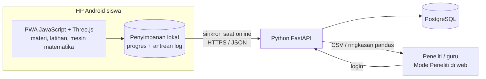

# ARCHITECTURE — Rancangan Teknis

**Stack yang dipilih: JavaScript (PWA, tanpa build) di sisi siswa + Python (FastAPI) di sisi server.**
FastAPI juga menyajikan berkas frontend, jadi cukup satu perintah dan satu layanan hosting.

## 1. Gambaran besar



**Pembagian tugas (penting):**
| Bagian | Tugas | Alasan |
|---|---|---|
| **Frontend (PWA JavaScript)** | Seluruh pembelajaran: materi, simulasi, garis bilangan, **mesin matematika** (penyelesaian, generator soal, deteksi miskonsepsi), penilaian, umpan balik | Harus tetap jalan **offline** dan cepat di HP kelas bawah. Siswa tidak boleh menunggu server untuk setiap langkah. |
| **Backend (Python FastAPI)** | Menerima log & angket, menyimpan ke database, mengelola kode kelas, dasbor & ekspor untuk peneliti, analisis ringkas (pandas) | Data penelitian terkumpul di satu tempat tanpa perlu mengumpulkan CSV dari tiap HP. |

> Mesin matematika **tidak** dipindah ke Python. Kalau begitu, aplikasi akan mati saat sinyal hilang.
> Python dipakai untuk hal yang memang membutuhkan server: penyimpanan pusat dan analisis data.

## 2. Pilihan teknologi

### Frontend: **JavaScript murni (ES modules), tanpa proses build, tanpa Node.js**
> Keputusan 11 Nov 2026: aplikasi memakai **Python + JavaScript**. Frontend ditulis dalam JavaScript biasa
> yang langsung dijalankan peramban. Tidak ada TypeScript, React, maupun Vite, jadi Node.js tidak diperlukan.

| Kebutuhan | Pilihan | Alasan |
|---|---|---|
| Bahasa | **JavaScript (ES2020, ES modules)** | Langsung jalan di Chrome Android; tidak perlu *build* |
| UI | Modul layar sederhana (`mount(el) → cleanup`) + template string | Ringan untuk HP kelas bawah; mudah dipahami |
| Gaya | CSS biasa + CSS variables (`src/styles/tokens.css`, DESIGN §2) | Konsisten |
| Rute | Router hash buatan sendiri (`src/main.js`), layar dimuat lazy dengan `import()` | Bekerja di hosting statis apa pun |
| Penyimpanan lokal | `localStorage` (S1); IndexedDB untuk outbox log (S6) | — |
| PWA | `manifest.webmanifest` + `sw.js` buatan sendiri (network-first + precache) | Bisa dipasang & jalan offline |
| Visual 2D | **SVG** buatan sendiri (`src/components/numberline.js`) | Garis bilangan HP, fallback 3D |
| Visual 3D | **Three.js r160** disimpan lokal di `vendor/three.module.min.js` | Hanya dimuat di layar 3D (lazy), tetap jalan offline |
| Uji | **pytest + mini-racer (V8)** menjalankan `src/math/*.js` dari Python; pytest juga memeriksa daftar precache | Teruji tanpa Node.js |

### Backend
| Kebutuhan | Pilihan | Alasan |
|---|---|---|
| Bahasa | **Python 3.12** | Sesuai pilihan pengguna; cocok untuk analisis data penelitian |
| Kerangka web | **FastAPI** | Modern, validasi otomatis (Pydantic), dokumentasi API otomatis di `/docs` |
| ORM | **SQLModel** (SQLAlchemy 2) | Satu kelas untuk skema DB dan validasi |
| Migrasi DB | **Alembic** | Perubahan skema tercatat |
| Database | **PostgreSQL** (produksi), **SQLite** (pengembangan lokal) | Lihat catatan hosting §7 |
| Analisis | **pandas** | Rekap skor, usaha mental, efisiensi instruksional |
| Keamanan | **passlib[bcrypt]** + JWT (`python-jose`/`pyjwt`) | Login peneliti |
| Paket | **uv** (atau `pip` + `venv`) | Instalasi cepat & terkunci |
| Uji & mutu | **pytest** + `httpx` TestClient, **ruff** | — |

**Tidak dipakai:** KaTeX/MathJax, pustaka UI besar, analitik pihak ketiga, Django (terlalu besar untuk kebutuhan API ini).

## 3. Struktur folder (monorepo)
```
langkah-linear/
├── CLAUDE.md
├── README.md
├── docs/
├── prototypes/lab-3d.html     # prototipe 3D mandiri
├── frontend/                  # disajikan apa adanya oleh FastAPI di "/"
│   ├── index.html  manifest.webmanifest  sw.js
│   ├── icons/  fonts/  vendor/three.module.min.js
│   └── src/
│       ├── main.js             # router hash + pendaftaran service worker
│       ├── lib/                # store.js, dom.js, tween.js
│       ├── math/linear.js      # ⚠ mesin matematika murni, TANPA import (diuji pytest via V8)
│       ├── content/            # keywords.js (tanpa import), modules.js
│       ├── components/         # mathexpr.js, numberline.js
│       ├── three/view.js       # fondasi adegan 3D
│       ├── features/           # home, enroll, settings, example, kamus, balance3d, flip3d …
│       └── styles/             # tokens.css, app.css
└── backend/
    ├── scripts/make_icons.py   # membuat ikon PWA
    ├── app/
    │   ├── main.py             # FastAPI app, CORS, API, + menyajikan frontend
    │   ├── config.py           # pengaturan dari .env
    │   ├── db.py               # engine & sesi
    │   ├── models.py           # SQLModel: Classroom, Student, Event, SurveyResponse, Researcher
    │   ├── schemas.py          # Pydantic request/response
    │   ├── security.py         # hash password, JWT
    │   ├── routers/
    │   │   ├── student.py      # /enroll, /events, /survey
    │   │   └── research.py     # /auth, /classes, /export, /summary
    │   └── analysis.py         # fungsi pandas
    ├── alembic/
    ├── tests/
    ├── pyproject.toml
    └── .env.example
```

## 4. Model data

### 4.1 Frontend (bentuk objek JavaScript, ditulis dengan notasi tipe agar mudah dibaca)
```ts
type Rel = '=' | '<' | '>' | '<=' | '>=';
interface LinearExpr { a: number; b: number }            // a·x + b
interface Problem {
  id: string; type: 'PLSV' | 'PtLSV';
  form: 'x+b=c' | 'ax=c' | 'ax+b=c' | 'ax+b=cx+d' | 'a(x+b)=c';
  left: LinearExpr; rel: Rel; right: LinearExpr;
  universe: 'R' | 'Z' | 'W' | 'N';
  seed?: number;
}
interface LogEvent {
  id: string;                     // UUID dibuat di HP → kunci anti-duplikat saat sinkron
  ts: number; studentCode: string; classCode: string; sessionId: string;
  module: string; itemId: string; stage?: 1|2|3|4;
  answer?: string; correct?: boolean; misconception?: string;
  hintsUsed: number; durationMs: number;
  effort?: number;                // skala Paas 1–9
  synced: 0 | 1;                  // status di outbox
}
```

### 4.2 Backend (tabel PostgreSQL)
| Tabel | Kolom utama |
|---|---|
| `classroom` | `id`, `code` (mis. `8B-KDH`, unik), `name`, `school_alias`, `survey_enabled`, `created_at` |
| `student` | `id`, `classroom_id`, `student_code` (mis. `S-07`), `device_token_hash`, `created_at`. **Tanpa nama asli.** |
| `event` | `id` (UUID dari klien, PK), `student_id`, `ts`, `module`, `item_id`, `stage`, `answer`, `correct`, `misconception`, `hints_used`, `duration_ms`, `effort`, `received_at` |
| `survey_response` | `id` (UUID), `student_id`, `ts`, `module`, `item_id`, `scale` (IL/EL/GL), `value` |
| `researcher` | `id`, `username`, `password_hash` |

## 5. API (v1)
Dokumentasi interaktif otomatis tersedia di `/docs` (Swagger) saat server berjalan.

**Untuk aplikasi siswa**
| Metode | Path | Fungsi |
|---|---|---|
| `GET` | `/api/v1/health` | Cek server hidup |
| `POST` | `/api/v1/enroll` | `{classCode, studentCode}` → `{deviceToken}`; dipanggil sekali saat siswa pertama kali memasukkan kode |
| `POST` | `/api/v1/events/batch` | Kirim ≤ 100 `LogEvent`; idempoten (UUID yang sudah ada diabaikan); balas daftar UUID yang diterima |
| `POST` | `/api/v1/survey/batch` | Sama, untuk jawaban angket |
| `GET` | `/api/v1/config` | Pengaturan kelas (mis. angket aktif/tidak) |

**Untuk peneliti** (butuh JWT)
| Metode | Path | Fungsi |
|---|---|---|
| `POST` | `/api/v1/auth/login` | Login peneliti |
| `GET/POST` | `/api/v1/research/classes` | Lihat/buat kode kelas |
| `GET` | `/api/v1/research/progress?class=` | Siapa sudah sampai modul mana |
| `GET` | `/api/v1/research/export.csv?class=&type=events\|survey` | Unduh data mentah (UTF-8 BOM) |
| `GET` | `/api/v1/research/summary?class=` | Ringkasan pandas: akurasi & rata-rata usaha mental per modul/tahap, skor IL/EL/GL, **efisiensi instruksional** E = (z<sub>performa</sub> − z<sub>usaha</sub>) / √2 |

## 6. Sinkronisasi offline-first
1. Setiap interaksi yang dinilai langsung ditulis ke **outbox** IndexedDB (`synced = 0`), tanpa menunggu jaringan.
2. Saat aplikasi dibuka, saat event `online`, dan setiap 60 detik ketika online, kirim maksimal 100 item per permintaan.
3. Server membalas UUID yang diterima, lalu klien menandainya `synced = 1`.
4. Gagal kirim? Coba lagi dengan jeda bertambah (5 s → 30 s → 2 m …). Siswa **tidak pernah** diblokir atau melihat pesan galat jaringan di layar belajar; status sinkron cukup berupa ikon kecil di Pengaturan.
5. Jika server sedang "tidur" (hosting gratis), permintaan pertama bisa lambat ±30–60 detik. Itu tidak masalah karena berjalan di latar.
6. **Cadangan:** ekspor CSV/JSON manual dari HP tetap tersedia di Mode Peneliti.

## 7. Hosting (gratis/murah)
| Bagian | Pilihan | Catatan |
|---|---|---|
| Frontend + Backend | **Satu layanan** di **Render** (free web service) atau **Railway**: FastAPI menyajikan API dan frontend sekaligus | Render gratis "tidur" setelah 15 menit tidak dipakai. Karena PWA sudah tersimpan di HP, siswa tetap bisa belajar walau server tidur |
| (opsional) Frontend terpisah | Netlify / Cloudflare Pages | Jika ingin frontend selalu cepat; atur `CORS_ORIGINS` |
| Database | **Neon** atau **Supabase** (PostgreSQL gratis) | ⚠ **Jangan** memakai SQLite di Render gratis: disknya tidak permanen, jadi **data penelitian bisa hilang** saat server restart |
| Alternatif sederhana | **PythonAnywhere** | Disk permanen, jadi SQLite aman, tetapi dukungan ASGI/FastAPI perlu dicek |

Backup: jadwalkan ekspor CSV mingguan selama periode uji coba.

## 8. Keamanan & privasi
- HTTPS wajib; CORS hanya mengizinkan domain frontend.
- Tidak ada nama asli; siswa diidentifikasi dengan `classCode + studentCode`. Daftar pemetaan kode → nama disimpan
  **offline oleh peneliti**, tidak di server.
- `deviceToken` disimpan sebagai hash; endpoint siswa hanya bisa **menulis** data miliknya, tidak bisa membaca data orang lain.
- Password peneliti di-hash (bcrypt); rahasia di `.env` (tidak di-commit).
- Pembatasan laju sederhana pada `/enroll` dan `/events/batch`.
- Persetujuan: siswa di bawah umur, jadi siapkan **izin sekolah/orang tua** dan tampilkan pemberitahuan singkat saat pertama masuk.

## 9. Anggaran kinerja (frontend)
| Metrik | Batas |
|---|---|
| JS awal (gzip) | ≤ 300 KB (tanpa Three.js) |
| Three.js (gzip) | ±160 KB, hanya dimuat di layar 3D, di-*precache* PWA agar tetap jalan offline |
| LCP (3G lambat, Lighthouse mobile) | ≤ 3 dtk |
| Lighthouse PWA / Aksesibilitas | lulus / ≥ 95 |
| Adegan 3D | ≥ 30 fps di HP RAM 3 GB; `pixelRatio ≤ 2`; ≤ 60 mesh; geometri & material dipakai bersama |

**Aturan render 3D:** render *on demand* (`src/lib/tween.js`). Frame hanya digambar saat ada animasi
atau interaksi, supaya baterai dan panas HP aman. Saat pindah layar, *dispose* geometri/tekstur. Fallback ke
komponen SVG bila `!WebGL`, `navigator.deviceMemory <= 2`, atau Mode ringan aktif.

## 10. Pengujian
- **Mesin matematika (pytest + V8)**: `backend/tests/test_math_engine.py` menjalankan `frontend/src/math/linear.js`.
  Kasus wajib: pembagian negatif membalik tanda, pembagian positif tidak membalik, variabel di dua ruas, tanda kurung,
  dan 2.000 soal generator diperiksa dengan 25 bilangan uji masing-masing.
- **Frontend (pytest)**: `test_frontend.py` memastikan berkas tersaji dengan tipe MIME yang benar dan semua berkas masuk PRECACHE `sw.js`.
- **E2E di peramban**: manual di HP Android untuk saat ini; Playwright (Python) bisa ditambahkan nanti.
- **Backend (pytest)**: enroll, batch idempoten (kirim 2× tidak menggandakan data), otorisasi peneliti,
  ekspor CSV, dan fungsi `analysis.py` dengan data contoh.
- **Uji lapangan teknis**: 1 HP Android kelas bawah, mode pesawat → kerjakan modul → online → data muncul di dasbor.
