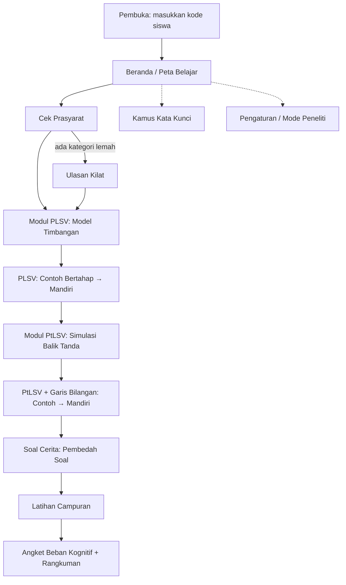

# DESIGN — *Langkah Linear*
Panduan desain antarmuka dan desain instruksional. Setiap keputusan UI harus bisa ditelusuri ke
prinsip Cognitive Load Theory (CLT) atau ke temuan wawancara (T1–T10, lihat [ANALISIS-KEBUTUHAN.md](ANALISIS-KEBUTUHAN.md)).

---

## 1. Prinsip desain (aturan yang tidak boleh dilanggar)

| # | Prinsip | Aturan konkret di aplikasi | Temuan |
|---|---|---|---|
| P1 | **Satu ide per layar** (*segmenting*) | Maks. 1 konsep baru + 1 aksi utama per layar; teks penjelasan ≤ 3 kalimat pendek | T5, T7 |
| P2 | **Siswa yang mengatur tempo** | Tidak ada auto-lanjut; selalu ada tombol "Langkah berikutnya" dan "Ulangi" | T7 |
| P3 | **Penanda yang konsisten** (*signaling*) | Kode warna + bentuk yang sama di semua layar (lihat §3); kata kunci selalu digarisbawahi bergelombang | T3, T6 |
| P4 | **Dekatkan yang berhubungan** (*spatial contiguity*, anti *split attention*) | Persamaan, garis bilangan, dan penjelasannya ada dalam satu layar tanpa *scroll*; soal cerita ringkas menempel di atas | T5 |
| P5 | **Hapus yang tidak perlu** (*coherence*) | Tanpa ilustrasi dekoratif, musik latar, atau maskot yang bergerak di layar belajar | — |
| P6 | **Jangan dobel** (*redundancy*) | Tidak menampilkan teks yang sama persis dengan narasi atau gambar | — |
| P7 | **Dari contoh ke mandiri** (*worked example → fading*) | Setiap tipe soal: Contoh penuh → 1 kosong → banyak kosong → mandiri | T8, T10 |
| P8 | **Tanya "mengapa"** (*self-explanation*) | Setelah konsep kunci, muncul 1 pertanyaan alasan berbentuk pilihan (bukan isian panjang) | T1, T9 |
| P9 | **Salah itu aman** | Umpan balik menjelaskan *bagian mana* yang keliru; tanpa suara/warna "hukuman"; tanpa nyawa/hati | — |
| P10 | **Prasyarat dulu** (*pre-training*) | Istilah (variabel, koefisien, konstanta, ruas) dikenalkan sebelum dipakai | T4 |

---

## 2. Gaya visual

### 2.1 Palet warna (token)
| Token | Terang | Gelap | Dipakai untuk |
|---|---|---|---|
| `--bg` | `#FAFAF7` | `#14161A` | Latar halaman |
| `--surface` | `#FFFFFF` | `#1E2127` | Kartu |
| `--text` | `#1F2328` | `#E8EAED` | Teks utama |
| `--text-muted` | `#5B6470` | `#A3ABB5` | Teks pendukung |
| `--primary` | `#2457C5` | `#7FA6FF` | Tombol utama, fokus |
| `--var` | `#2457C5` (biru) | `#7FA6FF` | **Variabel x** |
| `--const` | `#6B4FA0` (ungu) | `#B9A3E8` | **Konstanta** |
| `--sign` | `#C2410C` (oranye) | `#FDBA74` | **Tanda =, <, >, ≤, ≥** dan kata kunci |
| `--ok` | `#1A7F45` | `#6EE7A0` | Benar ✔ |
| `--warn` | `#A15C00` | `#FBBF24` | Perlu dicek ⚠ |

- Setiap warna semantik **wajib** disertai penanda non-warna: x diberi kotak, tanda diberi latar bulat, ✔/⚠ ikon.
- Merah **tidak dipakai** untuk "salah" (P9); pakai `--warn` + penjelasan.
- Semua pasangan teks/latar memenuhi kontras ≥ 4.5 : 1.

### 2.2 Tipografi
- Huruf: **Atkinson Hyperlegible** (dirancang agar mudah dibaca; membedakan 1/l/I dan 0/O) dengan cadangan `system-ui, sans-serif`. Disimpan lokal di proyek agar tetap jalan offline.
- Ukuran: isi 17 px, persamaan 22–28 px, judul 22 px; tinggi baris 1,5.
- Simbol matematika ditulis dengan karakter Unicode yang benar: `−` (minus U+2212, bukan tanda hubung), `≤`, `≥`, `×`, `÷`.
- Persamaan dirender dengan komponen sendiri (`<MathExpr>`), **bukan** KaTeX/MathJax, karena bentuk linear sederhana dan pustaka itu terlalu berat untuk HP kelas bawah.

### 2.3 Tata letak & sentuhan
- Satu kolom, lebar maks. konten 560 px (rata tengah di tablet).
- Tombol aksi utama menempel di bawah (zona jempol), tinggi ≥ 52 px, lebar penuh.
- Target sentuh ≥ 48 × 48 dp, jarak antar-target ≥ 8 dp.
- Ruang aman tepi ≥ 16 px; perhatikan *safe area* (lekukan layar & bilah navigasi Android).
- Mode gelap mengikuti setelan sistem.

### 2.4 Gerak
- Animasi hanya untuk menjelaskan perubahan (titik bergerak, timbangan miring, tanda berbalik), dengan durasi 300–600 ms.
- Menghormati `prefers-reduced-motion`, ditambah sakelar "Kurangi gerakan" di Pengaturan.

---

## 3. Bahasa visual matematika (konsisten di semua layar)

```
  2x  +  3   <   11
  ▣▣     ●●●  ◆   ●●●●●●●●●●●
  biru   ungu oranye
 (var)  (konst)(tanda)
```

| Unsur | Warna | Bentuk di timbangan | Bentuk di teks |
|---|---|---|---|
| Variabel x | biru `--var` | kotak `▣` | huruf miring dalam kotak berbingkai tipis |
| Konstanta | ungu `--const` | bulatan `●` | biasa |
| Tanda relasi | oranye `--sign` | — | dalam lencana bulat |
| Kata kunci soal cerita | oranye `--sign` | — | garis bawah bergelombang + bisa diketuk |

**Garis bilangan** (komponen `NumberLine`):
```
  ○ = tidak termasuk     ● = termasuk          ← legenda selalu tampil

  x < 3      ◄━━━━━━━━━━━━━━━○
            ─┼───┼───┼───┼───┼───┼───┼─
            −1   0   1   2   3   4   5

  x ≥ −1             ●━━━━━━━━━━━━━━━━━━━►
            ─┼───┼───┼───┼───┼───┼───┼─
            −2  −1   0   1   2   3   4
```
- Arsiran berupa garis tebal berwarna `--var` + panah. **Tidak** memakai arsiran miring seperti di catatan tangan, karena sulit dibaca di layar kecil.
- Untuk semesta bilangan bulat, yang ditampilkan hanya titik-titik ● pada bilangan yang memenuhi.
- Rentang otomatis: batas ± 5, dibulatkan ke kelipatan yang rapi.

---

## 4. Alur layar



---

## 5. Wireframe layar utama (lebar 360 px)

### 5.1 Beranda
```
┌────────────────────────────┐
│ Langkah Linear       ⚙     │
│ Halo, S-07 👋              │
│ ┌────────────────────────┐ │
│ │ Lanjutkan:             │ │
│ │ PtLSV · Balik Tanda    │ │
│ │ ▓▓▓▓▓▓░░░░  60%        │ │
│ └────────────────────────┘ │
│  ① Prasyarat          ✔    │
│  ② PLSV               ✔    │
│  ③ PtLSV              ◐    │
│  ④ Soal Cerita        ○    │
│  ⑤ Latihan Campuran   ○    │
│                            │
│ [ 📖 Kamus Kata Kunci ]    │
│ ┌────────────────────────┐ │
│ │      LANJUTKAN ▶       │ │
│ └────────────────────────┘ │
└────────────────────────────┘
```

### 5.2 Contoh Bertahap (F6)
```
┌────────────────────────────┐
│ ← PtLSV · Contoh 1   ▢▢▣▢  │  ← indikator tahap fading
│                            │
│   3x − 4 ≤ 5               │  ← soal menempel
│ ─────────────────────────  │
│ ① 3x − 4 + 4 ≤ 5 + 4       │
│    Tambah 4 di kedua ruas  │
│ ② 3x ≤ 9                   │
│    Sederhanakan            │
│ ③ ...                      │  ← langkah berikutnya belum muncul
│                            │
│ [ Ulangi ]  [ Langkah ▶ ]  │
└────────────────────────────┘
```

### 5.3 Simulasi Balik Tanda (F3)
```
┌────────────────────────────┐
│ ← Mengapa tandanya dibalik?│
│                            │
│     2   <   5              │
│    ×k      ×k              │
│   −4   >  −10              │  ← tanda berbalik + berkedip sekali
│                            │
│  ─●────────●──────┼──●──●─ │
│  −10      −4      0  2  5  │
│                            │
│ k:  −3 −2 [−1] 1 2 3       │  ← slider bertangga
│ ◯───────●────────────◯     │
│                            │
│ 💬 Apa yang terjadi pada   │
│    urutan titik saat k < 0?│
│ [ Lanjut ▶ ]               │
└────────────────────────────┘
```

### 5.4 Pembedah Soal Cerita (F5)
```
┌────────────────────────────┐
│ ← Soal Cerita 2      📖    │
│ ┌────────────────────────┐ │
│ │ Uang Rani Rp50.000.    │ │  kartu 1
│ │ [Diketahui][Ditanya][✕]│ │
│ └────────────────────────┘ │
│ ┌────────────────────────┐ │
│ │ Harga 1 buku Rp12.000. │ │  kartu 2
│ └────────────────────────┘ │
│ ┌────────────────────────┐ │
│ │ Berapa buku ~paling~   │ │  ← kata kunci (bergelombang)
│ │ ~banyak~ yang bisa     │ │
│ │ dibeli?                │ │
│ └────────────────────────┘ │
│  Langkah: ●──●──○──○       │  pilah · variabel · model · tafsir
│ [ Berikutnya ▶ ]           │
└────────────────────────────┘
```

### 5.5 Skala Usaha Mental (F8)
```
┌────────────────────────────┐
│ Seberapa berat usaha       │
│ pikiranmu untuk soal tadi? │
│                            │
│ 1  2  3  4  5  6  7  8  9  │
│ ○  ○  ○  ○  ○  ○  ○  ○  ○  │
│ sangat             sangat  │
│ ringan              berat  │
│                            │
│ [ Kirim ▶ ]                │
└────────────────────────────┘
```

---

## 6. Pola umpan balik
| Situasi | Tampilan |
|---|---|
| Benar | ✔ hijau + 1 kalimat penguat ("Tepat, kamu membagi dengan bilangan negatif, jadi tandanya berbalik.") |
| Salah jenis bulatan | ⚠ "Batasnya sudah benar. Apakah 3 **termasuk**? Lihat tandanya: < atau ≤?" |
| Lupa balik tanda | ⚠ Tampilkan F7 otomatis: "Coba masukkan x = 0 ke soal awal…" |
| Salah 2× | Tawarkan Petunjuk, bukan langsung kunci jawaban |
| Salah 3× | Tampilkan langkah lengkap, lalu beri soal kembar dengan angka lain |

## 7. Komponen UI inti
`AppShell` · `StepReveal` · `MathExpr` · `NumberLine` · `BalanceScale` · `FlipSimulator` ·
`StoryCard` · `KeywordChip` · `TileBuilder` (penyusun model) · `HintLadder` · `EffortScale` ·
`LikertItem` · `ProgressMap` · `StickyProblem` · `BottomActionBar` ·
`Scene3D` · `Balance3D` · `AlgebraBlocks3D` · `NumberLine3D` (lihat §8)

---

## 8. Visualisasi 3D (Three.js)

3D **bukan otomatis** mengurangi beban kognitif. Memutar kamera, membaca kedalaman, dan teks yang miring
bisa justru **menambah beban ekstrinsik**. Karena itu 3D hanya dipakai jika dimensi ketiga punya makna:

| Visual | Makna dimensi ke-3 | Status |
|---|---|---|
| **Timbangan aljabar 3D** | Benda nyata yang punya berat; kemiringan lengan memperlihatkan "tidak seimbang" secara langsung | Dipakai (F2) |
| **Blok aljabar 3D** | x = balok biru tinggi, 1 = kubus ungu; jumlah benda bisa dihitung, dan benda bisa diambil atau dibagi menjadi kelompok | Dipakai, diletakkan **di atas piringan timbangan** (F2) |
| **Garis bilangan 3D** | Perkalian dengan bilangan negatif = **memutar garis bilangan 180° di titik 0**. Titik-titik berayun lewat depan/belakang lalu bertukar sisi | Dipakai **hanya untuk animasi balik tanda** (F3). Garis bilangan untuk menjawab himpunan penyelesaian (F4) tetap **2D** |

### Aturan 3D (wajib)
1. **Kamera tetap**, sudut pandang ¾ dari depan-atas. Siswa hanya boleh memutar sedikit (±25°) dengan geser horizontal, dan ada tombol "kembalikan sudut pandang". **Tanpa zoom bebas dan tanpa orbit penuh.**
2. **Representasi ganda yang sinkron**: kartu persamaan simbolik (2D) selalu tampil di atas kanvas dan berubah bersamaan dengan benda 3D (*spatial & temporal contiguity*).
3. Teks dan label ditampilkan sebagai **lapisan HTML** di atas kanvas, bukan teks 3D, supaya selalu tegak dan tajam.
4. Gaya **low-poly, flat**, tanpa bayangan *real-time*, tanpa tekstur foto, tanpa latar pemandangan (*coherence*).
5. Warna dan bentuk mengikuti §3: x biru (balok), 1 ungu (kubus), titik tumpu/tanda oranye.
6. Gerak hanya terjadi sebagai akibat aksi siswa, berdurasi 400–1100 ms, dan tidak ada animasi menganggur.
7. **Fallback 2D otomatis** jika WebGL tidak tersedia, perangkat lemah (`deviceMemory ≤ 2`), atau siswa memilih "Mode ringan". Versi 2D (SVG) punya alur yang sama persis.
8. Kesalahan ditunjukkan oleh benda itu sendiri, misalnya timbangan miring saat operasi hanya dikenakan pada satu ruas, lalu dijelaskan dengan kalimat.

Prototipe yang bisa dicoba: [prototypes/lab-3d.html](../prototypes/lab-3d.html).
